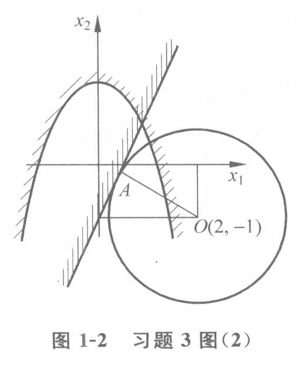

# 最优化问题的数学模型

## 数学模型的一般形式

**三要素**：设计变量；目标函数；约束条件。

**一般形式**：求设计变量；最小化目标函数；满足约束条件。

注：必须为极小化目标函数，若需求极大值则将目标函数反相。

## 最优化问题的分类

**线性最优化**：目标函数为全部变量的线性函数；

**非线性最优化**：目标函数至少为一个变量的非线性函数。

## 数学模型的组成

### 设计变量与设计空间

**参数**：预知参数；设计参数。

注：参数的选取必须独立。

**设计向量**：$X = [x_1,x_2,...,x_n]^T$

**设计空间**：每一个设计向量末端为一个设计点，所有的设计点构成设计空间

### 目标函数与等值线

**目标函数**（评价函数）：衡量设计方案优劣的定量判据

**目标函数等值线**：令$f(X) = C_i (i=1,2,...)$，得到的具有相同目标函数值的设计点构成的平面曲线、曲面等。

*性质*：表示了目标函数值的变化情况；稠密的地方函数值变化快，稀疏的地方变化慢；不同等值几何体不相交；一般在$X^*$附近的等值线近似为同心椭圆（球）族，且其中心为$X^*$。

### 约束条件与可行域

**可行域**：根据约束条件的几何意义，划分的可行的设计点的区域

注：为了其能够进行优化，一般等式约束的数量要小于变量数量。

**起作用约束**：约束边界正好通过某设计点的约束，为该设计点的一个起作用约束。

注：在可行域内部而非边界的设计点无起作用约束。

## 最优化问题的图解法

### 基本步骤

1. 确定设计空间
2. 画出由约束边界围成的约束可行域
3. 做出等值线，判断目标函数下降方向
4. 判断最优点

### 启示

1. 若最优解存在，最优解往往在下降方向上，且为等值线与可行域的最后一个交点或切点
2. 线性规划问题的可行域为凸多边形或凸多面体，等值线为一族平行直线或平面，故最优点在可行域的某个顶点上
3. 非线性优化问题的解往往在某个约束边界上

## 最优化模型分类

1. 线性与非线性
2. 单目标与多目标
3. 连续与离散
4. 静态与动态
5. 确定性与随机

## 例题

### 一

试建立下列问题的数学模型。

某建筑企业 3 年内有 5 项工程可以承担施工任务，每项选定的工程必须在 3 年内完成。每项工程的年建设费用、期望收入和各年可利用资金数如表 1-3 所列，试制订此企业的投标计划，以使 3 年的总收入最大。

| 工程               | 第一年费用／万元 | 第二年费用／万元 | 第三年费用／万元 | 各项工程预期收入／万元 |
| ------------------ | ---------------: | ---------------: | ---------------: | ---------------------: |
| 1                  |                5 |                1 |                8 |                     20 |
| 2                  |                4 |                7 |               10 |                     40 |
| 3                  |                3 |                9 |                2 |                     20 |
| 4                  |                7 |                4 |                1 |                     15 |
| 5                  |                8 |                6 |               10 |                     30 |
| 各年可用资金／万元 |               25 |               25 |               25 |                      — |

设是否投标 5 个项目的变量（0 或 1）为 $x_i$，$i=1,2,\ldots,5$，则该问题的数学模型为

$$
\min f(X)=-20x_1-40x_2-20x_3-15x_4-30x_5
$$

约束条件为

$$
\begin{aligned}
5x_1+4x_2+3x_3+7x_4+8x_5&\leq 25,\\
x_1+7x_2+9x_3+4x_4+6x_5&\leq 25,\\
8x_1+10x_2+2x_3+x_4+10x_5&\leq 25,\\
x_1,x_2,\ldots,x_5&\in\{0,1\}.
\end{aligned}
$$

### 二

#### 

用图解法求解以下最优化问题：

$$
\min f(X)=x_1^2+x_2^2-4x_1+2x_2+5
$$

约束条件为

$$
\begin{cases}
x_1^2+x_2-2\leq 0,\\
2x_1-x_2-1\leq 0.
\end{cases}
$$

#### 

如原书图 1-2 所示，最优点是等值线（圆）与线性约束边界的切点 $A$。分析可知，直线

$$
2x_1-x_2=1
$$

的斜率为 $2$，其垂线 $OA$ 的斜率为 $-1/2$，则半径 $OA$ 的方程为

$$
x_2+1=-\frac{x_1-2}{2}.
$$

于是联立解方程组

$$
\begin{cases}
x_1+2x_2=0,\\
2x_1-x_2=1.
\end{cases}
$$

得点 $A$ 的坐标

$$
x_1=0.4,\qquad x_2=-0.2.
$$

最优解为

$$
X^*=\begin{bmatrix}0.4\\-0.2\end{bmatrix},
\qquad f^*=3.2.
$$

