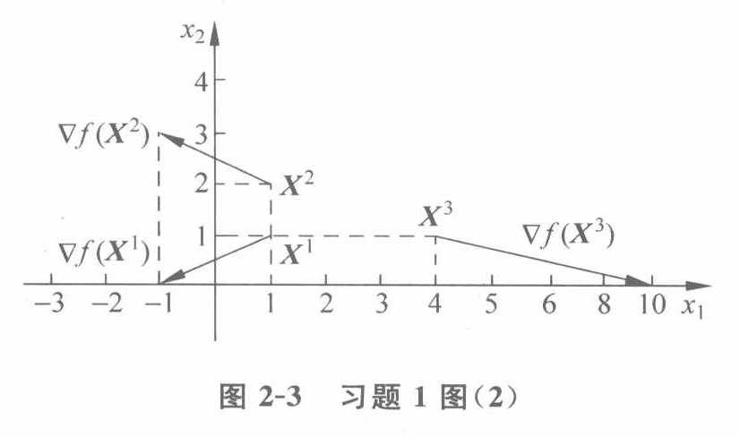

# 最优化问题的数学基础

## 梯度与方向导数

### 梯度

**梯度**：对于某多元函数$f(X^k)$，其梯度向量可以表示为$\vec\nabla f(X^k)=[\frac{\partial f(X^k)}{\part x_1},\frac{\partial f(X^k)}{\part x_2},...,\frac{\partial f(X^k)}{\part x_k}]^T$，为一个向量，表示该函数值增加最快的方向，数值为沿该方向的函数值变化率。

**性质**：与等值线垂直，或者称为外法线方向；仅为邻域性质。

### 方向导数

**方向导数**：对于某多元函数$f(X^k)$，其沿某方向的函数值变化率，为一个数值，可以表示为$\frac{\partial f(X^k)}{\part x_1}cos(\alpha_1)+\frac{\partial f(X^k)}{\part x_2}cos(\alpha_2)+...+\frac{\partial f(X^k)}{\part x_k}cos(\alpha_3)$，即$\vec\nabla f(X^k) \cdot \vec l$，其中$\vec l$为该方向的单位向量。即方向导数为梯度在该方向的投影。

## 多元函数泰勒展开

### 二阶泰勒展开近似

**泰勒二阶近似式**：$f(\vec X)=f(\vec X^k)+[\vec \nabla f(X^k)]^T \cdot [X-X^k]+\frac{1}{2}[X-X^k]^T \vec \nabla^2f(X^k)[X-X^k]$，其中$\vec \nabla^2f(X^k)$为该多元函数在$X^k$处的黑塞矩阵，具体表达为：$$\begin{bmatrix} \frac{\part ^2f(X^k)}{\part^2x_1} & \frac{\part ^2f(X^k)}{\part x_1 \part x_2} & \cdots & \frac{\part ^2f(X^k)}{\part x_1 \part x_k} \\ \frac{\part ^2f(X^k)}{\part x_2 \part x_1} & \frac{\part ^2f(X^k)}{\part^2x_2} & \cdots & \frac{\part ^2f(X^k)}{\part x_2 \part x_k} \\ \vdots & \vdots & \ddots & \vdots \\ \frac{\part ^2f(X^k)}{\part x_k \part x_1} & \frac{\part ^2f(X^k)}{\part x_k \part x_2}  & \cdots & \frac{\part ^2f(X^k)}{\part x_k \part x_k}\end{bmatrix}$$

## 多元函数极值条件

### 无约束条件

**无约束极值条件**：若在该点处多元函数的梯度为零，且其在该点处的黑塞矩阵正定，则该点为这个多元函数的一个极小值点。若其负定，则为该多元函数的一个极大值点。

### 有约束条件

**图解约束条件**：在不等式约束的极值点处，目标函数的负梯度位于起作用约束梯度形成的夹角或锥体内。

**KKT条件**：在不等式约束的极值点处，目标函数的负梯度为起作用约束梯度的非负线性组合。

### 

## 例题

### 一

##### 

求下列函数在点

$$
X^1=\begin{bmatrix}1\\1\end{bmatrix},\qquad
X^2=\begin{bmatrix}1\\2\end{bmatrix},\qquad
X^3=\begin{bmatrix}4\\1\end{bmatrix}
$$

的梯度及其模长，并作图表示。

$$
f(X)=x_1^2+x_2^2-4x_1-3x_2.
$$
由题知，函数的梯度为

$$
\nabla f(X)=
\begin{bmatrix}
2x_1-4\\
2x_2-3
\end{bmatrix}.
$$

所以，函数在 3 个点的梯度分别为

$$
\nabla f(X^1)=\begin{bmatrix}-2\\-1\end{bmatrix},
$$

$$
\nabla f(X^2)=\begin{bmatrix}-2\\1\end{bmatrix},
$$

$$
\nabla f(X^3)=\begin{bmatrix}4\\-1\end{bmatrix}.
$$

梯度的模分别为

$$
\left\|\nabla f(X^1)\right\|=\sqrt{5},
$$

$$
\left\|\nabla f(X^2)\right\|=\sqrt{5},
$$

$$
\left\|\nabla f(X^3)\right\|=\sqrt{17}.
$$

梯度的方向如原书图 2-3 所示。

### 二

求以下函数的极值点，并判断是极大点或极小点：

$$
f(X)=5x_1^2+4x_1x_2+8x_2^2-32x_1-56x_2.
$$
由题知

$$
\nabla f(X)=
\begin{bmatrix}
10x_1+4x_2-32\\
4x_1+16x_2-56
\end{bmatrix}.
$$

令 $\nabla f(X)=0$，即

$$
\begin{cases}
5x_1+2x_2-16=0,\\
x_1+4x_2-14=0.
\end{cases}
$$

联立解得

$$
x_1=2,\qquad x_2=3.
$$

因

$$
\nabla^2f(X)=
\begin{bmatrix}
10&4\\
4&16
\end{bmatrix}
$$

为正定矩阵，故

$$
X^*=\begin{bmatrix}2\\3\end{bmatrix}
$$

是原目标函数的极小点。

### 三

分别用 k-t 条件和作图法判断点

$$
X^1=\begin{bmatrix}2\\3\end{bmatrix}
\quad\text{和}\quad
X^2=\begin{bmatrix}2\\-3\end{bmatrix}
$$

是否为下面问题的最优解：

$$
\min f(X)=(x_1-3)^2+(x_2+5)^2
$$

约束条件为

$$
\begin{cases}
g_1(X)=(x_1-2)^2+x_2^2-9\leq 0,\\
g_2(X)=(x_1+2)^2+x_2^2-25\leq 0.
\end{cases}
$$
由题知

$$
\nabla f(X)=
\begin{bmatrix}
2x_1-6\\
2x_2+10
\end{bmatrix}.
$$

（1）用 k-t 条件判断点 $X^1=(2,3)^{\mathrm T}$

对点

$$
X^1=\begin{bmatrix}2\\3\end{bmatrix},
$$

因 $g_1(X^1)=0$、$g_2(X^1)=0$，知 $g_1(X)\leq 0$、$g_2(X)\leq 0$ 都是点 $X^1$ 的起作用约束。

将该点代入各梯度，得

$$
\nabla f(X^1)=
\left.
\begin{bmatrix}2x_1-6\\2x_2+10\end{bmatrix}
\right|_{X=X^1}
=\begin{bmatrix}-2\\16\end{bmatrix},
$$

$$
\nabla g_1(X^1)=
\left.
\begin{bmatrix}2x_1-4\\2x_2\end{bmatrix}
\right|_{X=X^1}
=\begin{bmatrix}0\\6\end{bmatrix},
$$

$$
\nabla g_2(X^1)=
\left.
\begin{bmatrix}2x_1+4\\2x_2\end{bmatrix}
\right|_{X=X^1}
=\begin{bmatrix}8\\6\end{bmatrix}.
$$

代入 k-t 条件有

$$
\begin{bmatrix}-2\\16\end{bmatrix}
+\lambda_1\begin{bmatrix}0\\6\end{bmatrix}
+\lambda_2\begin{bmatrix}8\\6\end{bmatrix}=0,
$$

即

$$
\begin{cases}
-2+8\lambda_2=0,\\
16+6\lambda_1+6\lambda_2=0.
\end{cases}
$$

联立解得

$$
\lambda_1=-\frac{35}{12},\qquad
\lambda_2=\frac14.
$$

因 $\lambda_1=-35/12<0$，可知

$$
X^1=\begin{bmatrix}2\\3\end{bmatrix}
$$

不是原不等式约束问题的最优解。

（2）用 k-t 条件判断点 $X^2=(2,-3)^{\mathrm T}$

同理，对点

$$
X^2=\begin{bmatrix}2\\-3\end{bmatrix},
$$

因 $g_1(X^2)=0$、$g_2(X^2)=0$，知两个约束都是点 $X^2$ 的起作用约束。

将该点代入各梯度，得

$$
\nabla f(X^2)=
\left.
\begin{bmatrix}2x_1-6\\2x_2+10\end{bmatrix}
\right|_{X=X^2}
=\begin{bmatrix}-2\\4\end{bmatrix},
$$

$$
\nabla g_1(X^2)=
\left.
\begin{bmatrix}2x_1-4\\2x_2\end{bmatrix}
\right|_{X=X^2}
=\begin{bmatrix}0\\-6\end{bmatrix},
$$

$$
\nabla g_2(X^2)=
\left.
\begin{bmatrix}2x_1+4\\2x_2\end{bmatrix}
\right|_{X=X^2}
=\begin{bmatrix}8\\-6\end{bmatrix}.
$$

代入 k-t 条件有

$$
\begin{bmatrix}-2\\4\end{bmatrix}
+\lambda_1\begin{bmatrix}0\\-6\end{bmatrix}
+\lambda_2\begin{bmatrix}8\\-6\end{bmatrix}=0,
$$

即

$$
\begin{cases}
-2+8\lambda_2=0,\\
4-6\lambda_1-6\lambda_2=0.
\end{cases}
$$

联立解得

$$
\lambda_1=\frac{5}{12},\qquad
\lambda_2=\frac14.
$$
