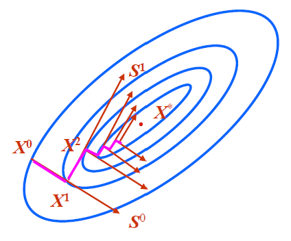
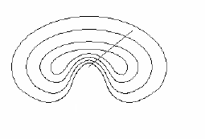

# 无约束最优化方法

## 基本问题

**基本迭代公式**：

$$
X^{k+1}=X^k+\alpha_kS^k,\qquad k=0,1,2,\ldots
$$

**基本问题**：选择搜索方向 $S^k$ 和步长 $\alpha_k$，使 $f(X^{k+1})<f(X^k)$。

**方法分类**：

- **导数法**：利用目标函数的一阶、二阶导数构造搜索方向，如梯度法、牛顿法、变尺度法、共轭梯度法；
- **模式法**：只利用目标函数值构造搜索方向，如坐标轮换法、鲍威尔法。

## 梯度法

梯度法选定的搜索方向为函数的负梯度方向，因此也称为最速下降法。其迭代格式为

$$
S^k=-\nabla f(X^k),\qquad
X^{k+1}=X^k+\alpha_kS^k=X^k-\alpha_k\nabla f(X^k),
$$

其中 $\alpha_k$ 为最优步长因子，由一维搜索确定：

$$
\min_{\alpha>0}f(X^k-\alpha\nabla f(X^k))
=f(X^k-\alpha_k\nabla f(X^k)).
$$

由一维搜索的极值条件

$$
\frac{\mathrm d}{\mathrm d\alpha}f(X^k+\alpha S^k)
=[\nabla f(X^k+\alpha S^k)]^TS^k=0,
$$

当 $\alpha=\alpha_k$ 时 $X^{k+1}=X^k+\alpha_kS^k$，故

$$
[\nabla f(X^{k+1})]^TS^k=0.
$$

又 $S^k=-\nabla f(X^k)$，所以

$$
[\nabla f(X^{k+1})]^T\nabla f(X^k)=0,
$$

即相邻两迭代点的梯度彼此正交，相邻的搜索方向相互垂直。

特点：

1. 相邻两迭代点的梯度是彼此正交的，相邻的搜索方向相互垂直。
2. 向极小点的逼近路径是一条曲折的锯齿形路线，而且越接近极小点，前进速度越慢。
3. 离极小点较远时，一次迭代得到的函数下降量较大，因此许多算法第一步采用梯度法。
4. 目标函数的性态、初始点的位置对收敛速度影响较大。
5. 梯度法只有线性收敛速度。

迭代步骤：

1. 给定初始点 $X^0$ 和收敛精度 $\varepsilon$，置 $k=0$。
2. 计算梯度，并构造搜索方向 $S^k=-\nabla f(X^k)$。
3. 一维搜索，求新的迭代点：$\min f(X^k-\alpha\nabla f(X^k))\rightarrow\alpha_k$，$X^{k+1}=X^k-\alpha_k\nabla f(X^k)$。
4. 收敛判断：若满足 $\lVert\nabla f(X^{k+1})\rVert\le\varepsilon$，则令 $X^*=X^{k+1}$，$f(X^*)=f(X^{k+1})$，终止计算；否则令 $k=k+1$，转第 2 步继续迭代。

## 共轭梯度法

### 共轭方向

**共轭**：设 $H$ 为 $n\times n$ 阶实对称正定矩阵，如果有两个 $n$ 维非零向量 $S_1$ 与 $S_2$，满足

$$
S_1^THS_2=0,
$$

则称向量 $S_1$ 与 $S_2$ 关于矩阵 $H$ 共轭。

**共轭向量（组）**：若非零向量组 $S_1,S_2,\ldots,S_n$ 满足

$$
S_i^THS_j=0\quad(i\ne j),
$$

则这组向量为 $H$ 的一组共轭向量。若 $H$ 为单位矩阵，则这组向量相互正交，所以正交是共轭的特例。

**共轭方向性质**：

（1）对于正定二次函数，从任意初始点 $X^0$ 出发，依次沿一组（$n$ 个）共轭方向一维搜索，最多 $n$ 次即可达到极小点。

**共轭方向法**：使用一组共轭方向进行连续的一维搜索得到极小值点。

**推论**：不同的初始点，不同的共轭方向组，不影响收敛性。

（2）从任意两点 $X_1^0$ 和 $X_2^0$ 出发，分别沿同一方向 $S^0$ 进行一维搜索，得到两个一维极小点 $X_1^1$ 和 $X_2^1$，则连接此两点所形成的向量

$$
S^1=X_1^1-X_2^1
$$

与原方向 $S^0$ 关于该函数的 Hessian 矩阵相共轭。

设 $A$ 为 $n\times n$ 阶实对称正定矩阵。

（3）若 $S_i\ (i=1,2,\ldots,n)$ 为关于矩阵 $A$ 共轭的一组非零向量组，则这一组向量线性无关。

**推论**：在 $n$ 维空间中相互共轭的非零向量的个数不超过 $n$ 个。

（4）设向量 $S_i^{(1)}\ (i=1,2,\ldots,n)$ 是一组线性无关的非零向量，则可构造出 $n$ 个非零向量 $S_i^{(2)}\ (i=1,2,\ldots,n)$，使其满足

$$
S_i^{(2)T}AS_j^{(2)}=0,\quad i\ne j,\ i,j=1,2,\ldots,n.
$$

**推论**：可由坐标轴方向来构造共轭向量。

### 共轭方向的产生

**平行搜索法**：从两个不同点出发，沿同一方向分别进行一维搜索，所得两个极小点的连线即为与原方向共轭的新方向，即上述性质（2）。

**向量组合法**：设 $S^0,S^1,\ldots,S^k$ 已关于 $H=\nabla^2f(X)$ 共轭，取基向量 $e^k$，令

$$
S^{k+1}=e^k-\sum_{i=0}^{k}
\frac{[S^i]^THe^k}{[S^i]^THS^i}S^i,
$$

则 $S^{k+1}$ 与 $S^0,S^1,\ldots,S^k$ 关于 $H$ 共轭。

**梯度组合法**：从 $X^k$ 出发，沿 $S^k$ 作一维搜索，令

$$
S^{k+1}=-\nabla f(X^{k+1})+\beta_kS^k.
$$

由共轭条件 $[S^k]^T\nabla^2f(X^{k+1})S^{k+1}=0$ 可解得

$$
\beta_k=
\frac{\lVert\nabla f(X^{k+1})\rVert^2}
{\lVert\nabla f(X^k)\rVert^2}.
$$

可见，只需利用相邻两点的梯度即可构造共轭方向。

### 共轭梯度算法

**基本思想**：初始搜索方向取负梯度方向 $S^0=-\nabla f(X^0)$；以后将负梯度方向与上一搜索方向线性组合，构造关于 Hessian 矩阵共轭的方向，沿共轭方向逐次迭代逼近最优点。

**迭代公式**：

$$
X^{k+1}=X^k+\alpha_kS^k,\qquad
S^{k+1}=-\nabla f(X^{k+1})+\beta_kS^k.
$$

迭代步骤：

1. 给定 $X^0$ 和收敛精度 $\varepsilon>0$。
2. 计算 $S^0=-\nabla f(X^0)$；置 $k=0$。
3. 计算 $\alpha_k$：$f(X^k+\alpha_kS^k)=\min f(X^k+\alpha S^k)\Rightarrow\alpha_k$。
4. 由 $X^{k+1}=X^k+\alpha_kS^k$ 计算 $\nabla f(X^{k+1})$。
5. 收敛判断：若 $\lVert\nabla f(X^{k+1})\rVert\le\varepsilon$，终止算法，最优解为 $X^*=X^{k+1}$；否则继续搜索。
6. 若 $k=n$，令 $X^0=X^{k+1}$，返回第 2 步；否则继续搜索。
7. 计算 $\beta_k$，且 $S^{k+1}=-\nabla f(X^{k+1})+\beta_kS^k$。
8. 令 $k=k+1$，返回第 3 步。

**特点**：

1. 只需计算一阶导数，不需要计算 Hessian 矩阵及其逆矩阵，存储量小。
2. 对 $n$ 元正定二次函数，最多 $n$ 次迭代即可达到极小点，具有二次终止性。
3. 收敛速度介于梯度法与牛顿法之间，通常明显优于梯度法。
4. 每 $n$ 步重新取负梯度方向，可减小舍入误差的影响。

## 牛顿法

### 基本牛顿法

**基本思想**：在 $X^k$ 处用二次函数近似 $f(X)$：

$$
f(X)\approx f(X^k)+[\nabla f(X^k)]^T(X-X^k)
+\frac12(X-X^k)^TH(X^k)(X-X^k).
$$

令其梯度为零：

$$
\nabla f(X^k)+H(X^k)(X-X^k)=0,
$$

解得

$$
X^{k+1}=X^k-[H(X^k)]^{-1}\nabla f(X^k).
$$

即搜索方向为

$$
S^k=-[H(X^k)]^{-1}\nabla f(X^k),
$$

其中 $H(X^k)$ 为该点的 Hessian 矩阵。基本牛顿法无需一维搜索，步长因子始终为 $1$。

特点：

（1）对于正定二次函数，$X^{k+1}$ 是精确极小点，方向 $S^k$ 直指函数的极小点。

（2）用基本牛顿法求解正定二次函数时，无论从哪个初始点出发，计算所得牛顿方向直指极小点，而且步长等于 $1$。

（3）对于一般非线性函数，点 $X^{k+1}$ 只是原函数的一个近似极小点，故将此点作为下一个迭代点。

（4）对于非正定函数，由上式得到的点 $X^{k+1}$ 不能始终保持函数的下降性，基本牛顿法有可能失败。如图所示。

### 阻尼牛顿法

与基本牛顿法相比，阻尼牛顿法引入可变的最优步长因子，称为阻尼因子，而搜索方向不变：

$$
S^k=-[H(X^k)]^{-1}\nabla f(X^k),\qquad
X^{k+1}=X^k+\alpha_kS^k,
$$

其中 $\alpha_k$ 由一维搜索确定。

迭代步骤：

1. 给定 $X^0$ 和收敛精度 $\varepsilon>0$；置 $k=0$。
2. 计算 $\nabla f(X^k)$、$\nabla^2f(X^k)$ 和 $[\nabla^2f(X^k)]^{-1}$。
3. 选择 $S^k=-[\nabla^2f(X^k)]^{-1}\nabla f(X^k)$ 作为搜索方向。
4. 进行一维搜索，确定最优步长 $\alpha_k$，得到新的迭代点 $X^{k+1}=X^k+\alpha_kS^k$。
5. 收敛判断：若 $\lVert\nabla f(X^{k+1})\rVert\le\varepsilon$，则可终止搜索，最优解为 $X^*=X^{k+1}$；否则继续搜索。
6. 令 $k=k+1$，返回第 2 步。

特点：

（1）构造搜索方向利用了函数的所有一阶导数和二阶导数，产生的搜索方向直指极小点。

（2）对于正定二次函数，从任意初始点出发，一次迭代即可得到极小点；对于一般函数，迭代次数通常比其它算法少。

（3）每次迭代都需要计算函数的二阶导数矩阵及其逆矩阵，计算量大、计算时间长、计算速度较慢。

（4）计算中若用差分代替微分，所得梯度和二阶导数矩阵以及求得的牛顿方向都存在较大误差。

## 变尺度法（DFP）

变尺度法为拟牛顿法的一种，基本思想是构造一个矩阵，使其在计算中以递推形式逐步逼近 $[H(X^k)]^{-1}$，从而避免计算二阶导数矩阵及其逆矩阵。

### 坐标变换

设 $H(X^k)=\nabla^2f(X^k)$ 正定。由线性代数知，存在可逆矩阵 $U$，使

$$
U^TH(X^k)U=I.
$$

令

$$
X-X^k=UY,
$$

则二次函数在 $X^k$ 附近化为

$$
\varphi(Y)=\frac12Y^TU^TH(X^k)UY
+[\nabla f(X^k)]^TUY+f(X^k)
=\frac12Y^TY+[\nabla f(X^k)]^TUY+f(X^k).
$$

并且

$$
[H(X^k)]^{-1}=UU^T.
$$

坐标变换的作用是改善目标函数的性态，使等值线（面）接近同心圆（球），从而加快收敛。

### 变尺度法的基本原理

取 $A^k=UU^T$，则

$$
S^k=-A^k\nabla f(X^k),\qquad
X^{k+1}=X^k-\alpha_kA^k\nabla f(X^k),
$$

其中 $A^k$ 称为变尺度矩阵。构造 $A^k$ 应满足以下要求：

1. **下降性**：$A^k$ 对称正定，此时 $S^k$ 为下降方向；
2. **逼近性**：$A^k$ 逐步逼近 $[H(X^k)]^{-1}$，即满足 DFP 条件；
3. **递推性**：$A^{k+1}=A^k+E^k$，便于迭代计算。

由二阶泰勒展开

$$
\nabla f(X^{k+1})\approx\nabla f(X^k)+H(X^k)(X^{k+1}-X^k),
$$

可得

$$
[H(X^k)]^{-1}\Delta g^k=\Delta X^k,
$$

其中 $\Delta X^k=X^{k+1}-X^k$，$\Delta g^k=\nabla f(X^{k+1})-\nabla f(X^k)$。用 $A^k$ 近似 $[H(X^k)]^{-1}$，即得 DFP 条件：

$$
A^k\Delta g^k=\Delta X^k.
$$

### 迭代公式与校正矩阵

**迭代公式**：

$$
X^{k+1}=X^k-\alpha_kA^k\nabla f(X^k)=X^k+\alpha_kS^k,
\qquad S^k=-A^k\nabla f(X^k).
$$

当 $A^k=I$ 时为梯度法的迭代公式；当 $A^k=[H(X^k)]^{-1}$ 时为阻尼牛顿法的迭代公式。通常取 $A^0=I$，故第一步为梯度法，之后逐步逼近牛顿方向。

**DFP 校正矩阵**：

$$
E^k=
\frac{\Delta X^k[\Delta X^k]^T}{[\Delta g^k]^T\Delta X^k}
-\frac{A^k\Delta g^k[\Delta g^k]^TA^k}
{[\Delta g^k]^TA^k\Delta g^k}.
$$

**BFGS 校正矩阵**：

$$
E^k=\frac{1}{[\Delta X^k]^T\Delta g^k}
\left\{
\Delta X^k[\Delta X^k]^T
+\frac{\Delta X^k[\Delta X^k]^T[\Delta g^k]^TA^k\Delta g^k}
{[\Delta X^k]^T\Delta g^k}
-A^k\Delta g^k[\Delta g^k]^T
-\Delta X^k[\Delta g^k]^TA^k
\right\}.
$$

BFGS 法与 DFP 法类似，但数值稳定性更好，常用来替代 DFP 法。

### 迭代步骤

1. 给定 $X^0$ 和收敛精度 $\varepsilon>0$。
2. 计算 $\nabla f(X^0)$，取 $A^0=I$，置 $k=0$。
3. 构造搜索方向 $S^k=-A^k\nabla f(X^k)$。
4. 进行一维搜索，得到 $\alpha_k$ 和迭代点 $X^{k+1}=X^k+\alpha_kS^k$。
5. 收敛判断：若 $\lVert\nabla f(X^{k+1})\rVert\le\varepsilon$，则令 $X^*=X^{k+1}$，$f(X^*)=f(X^{k+1})$，终止计算；否则继续下一步。
6. 若 $k<n-1$，继续下一步；若 $k=n-1$，令 $X^0=X^{k+1}$，返回第 2 步。
7. 计算 $\nabla f(X^k)$、$\Delta X^k$、$\Delta g^k$、$E^k$，构造新的变尺度矩阵 $A^{k+1}=A^k+E^k$，置 $k=k+1$，返回第 3 步。

### 特点

1. 不需要计算 Hessian 矩阵及其逆矩阵，只需一阶导数。
2. 具有超线性收敛速度；对正定二次函数，最多 $n$ 次迭代达到极小点。
3. 需要存储 $n\times n$ 矩阵 $A^k$，维数很高时存储量较大。
4. BFGS 法数值稳定性更好，是工程中常用的变尺度法。

## 鲍威尔法

根据共轭方向的性质：从任意两点 $X_1^0$ 和 $X_2^0$ 出发，分别沿同一方向 $S^0$ 进行一维搜索，得到两个一维极小点 $X_1^1$ 和 $X_2^1$，则连接此两点所形成的向量 $S^1=X_1^1-X_2^1$ 与原方向 $S^0$ 关于该函数的 Hessian 矩阵共轭。

将平行搜索特性推广到 $n$ 维：

设 $X_1^0$、$X_2^0$ 是 $R^n$ 中的两个不同点，$\{S_1,S_2,\ldots,S_l\}$ 是 $R^n$ 中一组线性无关的方向，定义如下两个平行的线性簇

$$
L_1=\left\{X_1^0+\sum_{i=1}^{l}\alpha_iS_i
\mid\alpha_i\in R,\ i=1,2,\ldots,l\right\},
$$

$$
L_2=\left\{X_2^0+\sum_{i=1}^{l}\alpha_iS_i
\mid\alpha_i\in R,\ i=1,2,\ldots,l\right\}.
$$

如分别用 $X_1^1$ 和 $X_2^1$ 表示 $f(X)$ 在 $L_1$ 和 $L_2$ 上的极小点，那么 $X_1^1-X_2^1$ 与 $S_1,S_2,\ldots,S_l$ 共轭。

鲍威尔法利用平行搜索构造共轭方向，并沿共轭方向进行一维搜索。由于构造方向不需要计算导数，因此属于模式法。

### 基本迭代格式

以 $n$ 个基向量 $e_0,e_1,\ldots,e_{n-1}$ 组成初始方向组 $P_0$。从 $X_0^0$ 出发，沿 $P_0$ 中的 $n$ 个方向依次进行一维搜索，得 $X_n^0$；令

$$
S^0=X_n^0-X_0^0,
$$

沿 $S^0$ 一维搜索得 $X_{n+1}^0$，并以 $X_{n+1}^0$ 作为下一轮起点 $X_0^1$。用 $S^0$ 替换原方向组中的某个方向，形成新的方向组 $P_1$，重复上述过程。

### 基本鲍威尔法

基本鲍威尔法固定淘汰方向组的第一个方向：

$$
\begin{aligned}
P_0&:\ e_0,e_1,\ldots,e_{n-1}\ \to\ S^0,\\
P_1&:\ e_1,e_2,\ldots,e_{n-1},S^0\ \to\ S^1,\\
&\ \vdots\\
P_{n-1}&:\ e_{n-1},S^0,\ldots,S^{n-2}\ \to\ S^{n-1}.
\end{aligned}
$$

**迭代步骤**：

1. 给定初始点 $X^0$ 和精度 $\varepsilon>0$；置 $k=1$，$X_0^k=X^0$，$S_i^k=e_i\ (i=0,1,\ldots,n-1)$。
2. 从 $X_0^k$ 出发，依次沿 $S_i^k$ 进行一维搜索，得 $X_i^k\ (i=1,2,\ldots,n)$。
3. 令 $S_n^k=X_n^k-X_0^k$，沿 $S_n^k$ 一维搜索得 $X_{n+1}^k$。若 $\lVert X_{n+1}^k-X_0^k\rVert\le\varepsilon$，停止，令 $X^*=X_{n+1}^k$。
4. 令 $X_0^{k+1}=X_{n+1}^k$；新方向组为 $S_i^{k+1}=S_{i+1}^k\ (i=0,1,\ldots,n-2)$，$S_{n-1}^{k+1}=S_n^k$。置 $k=k+1$，返回第 2 步。

基本鲍威尔法在迭代中可能因方向组线性相关而退化为低维搜索，导致找不到真正的极小点，因此需要修正。

### 修正鲍威尔法

在得到新方向 $S_n^k=X_n^k-X_0^k$ 后，先计算反射点

$$
X_{n+2}^k=2X_n^k-X_0^k,
$$

并令

$$
f_1=f(X_0^k),\qquad f_2=f(X_n^k),\qquad f_3=f(X_{n+2}^k).
$$

找出上一轮中函数值下降最多的方向 $S_m^k$ 及其下降量

$$
\Delta_m=\max_{i=1,\ldots,n}\{f(X_{i-1}^k)-f(X_i^k)\}.
$$

若同时满足

$$
f_3<f_1,
$$

$$
(f_1-2f_2+f_3)(f_1-f_2-\Delta_m)^2
<\frac12\Delta_m(f_1-f_3)^2,
$$

则 $S_n^k$ 与原方向组线性无关，可以选用 $S_n^k$ 替换 $S_m^k$；否则不替换。

**替换方法**：

- 满足条件：删去 $S_m^k$，其余方向依次前移，$S_n^k$ 放在末尾；从 $X_n^k$ 出发沿 $S_n^k$ 一维搜索得 $X_{n+1}^k$，令 $X_0^{k+1}=X_{n+1}^k$。
- 不满足条件：方向组保持不变；若 $f_2<f_3$，令 $X_0^{k+1}=X_n^k$，否则令 $X_0^{k+1}=X_{n+2}^k$。

**迭代步骤**：

1. 给定初始点 $X^0$ 和精度 $\varepsilon>0$；置 $k=1$，$X_0^k=X^0$，$S_i^k=e_i$。
2. 依次沿 $S_i^k$ 一维搜索，得 $X_i^k$，计算 $\Delta_i$ 和 $\Delta_m$，确定 $S_m^k$。
3. 若 $\lVert X_n^k-X_0^k\rVert\le\varepsilon$，停止，令 $X^*=X_n^k$。
4. 构造 $S_n^k=X_n^k-X_0^k$，计算反射点 $X_{n+2}^k$ 及 $f_1,f_2,f_3$。
5. 按判别条件决定是否替换：若替换，沿 $S_n^k$ 一维搜索得 $X_{n+1}^k$，令 $X_0^{k+1}=X_{n+1}^k$；否则按上述规则取 $X_0^{k+1}$。
6. 置 $k=k+1$，返回第 2 步。

### 特点

1. 只需计算函数值，不需要导数，属于模式法。
2. 对 $n$ 元正定二次函数，最多经过 $n$ 轮迭代、$n(n+1)$ 次一维搜索即可达到极小点。
3. 方向产生简单，但一维搜索次数较多；修正算法可避免方向组线性相关导致的降维。
4. 鲍威尔法是模式法中较为有效的方法，具有超线性收敛性；但维数较高时收敛速度相对较慢。

## 方法比较

| 方法 | 所需导数 | 收敛速度 | 主要特点 |
|:---|:---|:---|:---|
| 梯度法 | 一阶 | 线性 | 计算简单、存储量小；初期下降快，接近极小点慢 |
| 牛顿法 | 一阶、二阶 | 二次 | 收敛快；需计算 Hessian 矩阵及其逆矩阵 |
| 变尺度法 | 一阶 | 超线性 | 不需 Hessian 矩阵，兼有较好收敛性与计算量 |
| 共轭梯度法 | 一阶 | 超线性、二次终止性 | 存储量小，适合多维问题 |
| 鲍威尔法 | 不需要 | 超线性 | 只需函数值，一维搜索次数较多 |

## 例题

### 一

习题 1-(1)：梯度法（作两次迭代）。

用梯度法求解（作两次迭代）：

$$
\min f(X)=x_1^2+4x_2^2,\qquad X^0=(4,4)^\mathrm T.
$$

**解**：第一次迭代：

$$
\nabla f(X^0)=(2x_1,8x_2)^\mathrm T=(8,32)^\mathrm T,\quad
S^0=-\nabla f(X^0)=(-8,-32)^\mathrm T.
$$

$$
X^1=X^0+\alpha S^0=(4-8\alpha,\,4-32\alpha)^\mathrm T,
$$

$$
f(X^1)=(4-8\alpha)^2+4(4-32\alpha)^2.
$$

令 $\mathrm df/\mathrm d\alpha=-16(4-8\alpha)-256(4-32\alpha)=0$，得 $\alpha=17/130\approx0.1308$。因此

$$
X^1\approx(2.954,-0.185)^\mathrm T,\quad f(X^1)\approx8.862,
$$

$$
\nabla f(X^1)\approx(5.908,-1.480)^\mathrm T,\quad\|\nabla f(X^1)\|\approx6.09.
$$

第二次迭代：

$$
S^1=-\nabla f(X^1)\approx(-5.908,1.480)^\mathrm T,
$$

$$
X^2=X^1+\alpha S^1\approx(2.954-5.908\alpha,\,-0.185+1.480\alpha)^\mathrm T.
$$

令下式对 $\alpha$ 的导数为零：

$$
f(X^2)=(2.954-5.908\alpha)^2+4(-0.185+1.480\alpha)^2,
$$

解得 $\alpha\approx0.4251$，于是

$$
X^2\approx(0.4424,0.4430)^\mathrm T,\quad f(X^2)\approx0.9806,\quad
\nabla f(X^2)\approx(0.8849,3.5436)^\mathrm T.
$$

*原书书页 47–48；PDF 第 54–55 页。*

### 二

习题 2-(1)：牛顿法。

用牛顿法求解：

$$
\min f(X)=x_1^2+4x_2^2+9x_3^2-2x_1-18x_3,\qquad X^0=(1,2,1)^\mathrm T.
$$

**解**：初始点的梯度、Hessian 矩阵及其逆矩阵分别为

$$
\nabla f(X^0)=(2x_1-2,8x_2,18x_3-18)^\mathrm T=(0,16,0)^\mathrm T,
$$

$$
\nabla^2 f(X^0)=\operatorname{diag}(2,8,18),\qquad
[\nabla^2 f(X^0)]^{-1}=\operatorname{diag}(1/2,1/8,1/18).
$$

牛顿方向 $S^0=-[\nabla^2 f(X^0)]^{-1}\nabla f(X^0)=(0,-2,0)^\mathrm T$，故

$$
X^1=X^0+\alpha S^0=(1,2-2\alpha,1)^\mathrm T,\qquad
f(X^1)=4(2-2\alpha)^2-10.
$$

令 $f'(\alpha)=0$，得 $\alpha=1$，从而 $X^1=(1,0,1)^\mathrm T$、$f(X^1)=-10$。此时 $\nabla f(X^1)=0$，所以最优解为

$$
X^*=(1,0,1)^\mathrm T,\qquad f^*=-10.
$$

*原书书页 51；PDF 第 58 页。*

### 三

习题 3-(1)：变尺度法。

用变尺度法求解：

$$
\min f(X)=x_1^2+x_2^2-x_1x_2-10x_1-4x_2,\qquad X^0=(1,1)^\mathrm T.
$$

**解**：先沿负梯度方向迭代。因为

$$
\nabla f(X^0)=(2x_1-x_2-10,\,-x_1+2x_2-4)^\mathrm T=(-9,-3)^\mathrm T,
$$

所以 $S^0=(9,3)^\mathrm T$，$X^1=(1+9\alpha,1+3\alpha)^\mathrm T$。将其代入 $f$ 并令 $f'(\alpha)=0$，得

$$
\alpha=5/7\approx0.714,\qquad X^1\approx(7.429,3.143)^\mathrm T,\qquad
\nabla f(X^1)\approx(1.714,-5.143)^\mathrm T.
$$

再沿变尺度方向迭代。取 $A^0=I$，记 $\Delta X=X^1-X^0$、$\Delta g=\nabla f(X^1)-\nabla f(X^0)$，按原书的逆 Hessian 更新式

$$
A^1=A^0+\frac{\Delta X\Delta X^\mathrm T}{\Delta g^\mathrm T\Delta X}
-\frac{A^0\Delta g\Delta g^\mathrm TA^0}{\Delta g^\mathrm TA^0\Delta g}.
$$

原书后续计算采用 $\Delta X\approx(6.426,2.142)^\mathrm T$、$\Delta g\approx(10.71,-2.142)^\mathrm T$，得到

$$
A^1\approx\begin{pmatrix}0.681&0.406\\0.406&1.033\end{pmatrix},\qquad
S^1=-A^1\nabla f(X^1)\approx(0.923,4.617)^\mathrm T.
$$

令 $X^2=X^1+\alpha S^1$，代入目标函数作一维搜索，原书给出 $\alpha\approx0.619$，于是

$$
X^2\approx(7.997,6.000)^\mathrm T,\qquad
\nabla f(X^2)\approx(-0.006,-0.003)^\mathrm T,\qquad
\|\nabla f(X^2)\|\approx0.0067.
$$

考虑计算舍入，原问题的精确最优解为

$$
X^*=(8,6)^\mathrm T,\qquad f^*=-52.
$$

*原书书页 53–54；PDF 第 60–61 页。*

### 四

习题 4-(1)：共轭梯度法。

用共轭梯度法求解：

$$
\min f(X)=(x_1-1)^2+2(x_2-2)^2,\qquad X^0=(3,1)^\mathrm T.
$$

**解**：第一次沿负梯度方向迭代：

$$
\nabla f(X^0)=(2(x_1-1),4(x_2-2))^\mathrm T=(4,-4)^\mathrm T,\quad
S^0=(-4,4)^\mathrm T.
$$

$$
X^1=(3-4\alpha,1+4\alpha)^\mathrm T,\qquad
f(X^1)=(2-4\alpha)^2+2(-1+4\alpha)^2.
$$

令 $f'(\alpha)=-8(2-4\alpha)+16(-1+4\alpha)=0$，得 $\alpha=1/3$，所以

$$
X^1=(5/3,7/3)^\mathrm T,\qquad\nabla f(X^1)=(4/3,4/3)^\mathrm T.
$$

第二次沿共轭梯度方向迭代：

$$
\beta=\frac{\|\nabla f(X^1)\|^2}{\|\nabla f(X^0)\|^2}=\frac19,\qquad
S^1=-\nabla f(X^1)+\beta S^0=(-16/9,-8/9)^\mathrm T.
$$

$$
X^2=(5/3-16\alpha/9,\,7/3-8\alpha/9)^\mathrm T.
$$

将 $X^2$ 代入 $f$，令 $f'(\alpha)=0$，得 $\alpha=3/8$，于是 $X^2=(1,2)^\mathrm T$、$\nabla f(X^2)=0$。故

$$
X^*=(1,2)^\mathrm T,\qquad f(X^*)=0.
$$

*原书书页 55–56；PDF 第 62–63 页。*
