# 无约束最优化方法

## 基本问题

**基本迭代公式**:$X^{k+1}=X^k+\alpha_k S^k,k=1,2,3,...$

**基本问题**:选择搜索方向$S^k$

## 共轭梯度法

### 梯度法

梯度法选定的搜索方向即为函数的负梯度方向，即$S^k=-\nabla f(X^k)$，$X^{k+1}=X^k-a_k\nabla f(X^k)$，其中$a_k$为最优步长因子，是第$k$轮一维搜索的目标。

根据一维搜索，其搜索的结果一定与某等值线相切。在此处作为下一次搜索方向的的负梯度则一定与上次的搜索方向垂直。

特点：

1. 相邻两迭代点的梯度是彼此正交的，相邻的搜索方向相互垂直。
2. 向极小点的逼近路径是一条曲折的锯齿形路线，而且越接近极小点，前进速度越慢。
3. 离极小点较远时，一次迭代得到的函数下降量较大。
4. 目标函数的性态、初始点的位置，收敛速度影响较大。

迭代步骤：

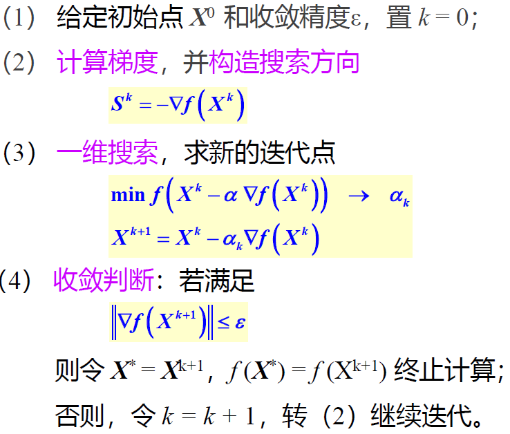

### 共轭梯度法

#### 

**共轭**:设$H$为$n×n$阶实对称正定矩阵，如果有两个$n$维非零向量$S_1$与$S_2$，满足$S_1^T H S_2=0$，则称向量$S_1$与$S_2$关于矩阵$H$共轭。

**共轭向量（组）**:若非零向量组$S_1,S_2,...,S_n$满足$S_i^THS_j=0$，则这组向量为$H$的一组共轭向量。若$H$为单位矩阵，则这组向量相互正交。

**共轭方向性质**:

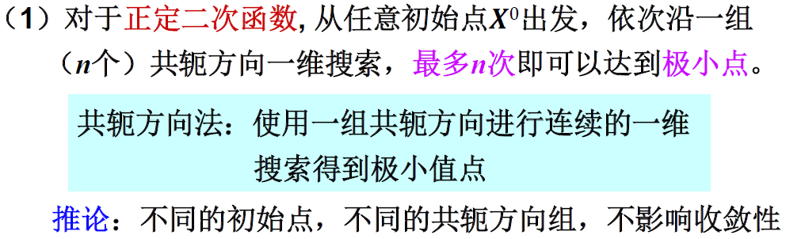

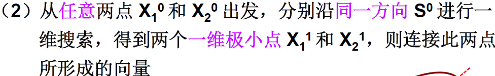

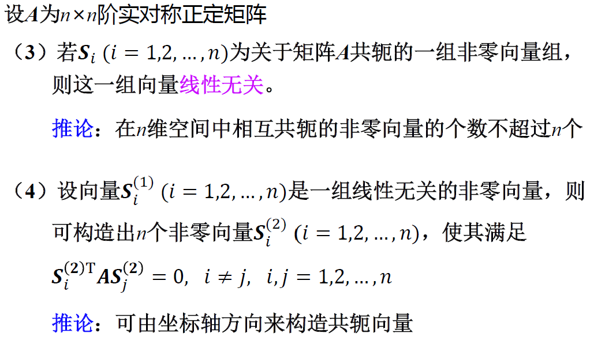

共轭梯度法的搜索方向基于共轭方向对负梯度方向进行修正，即$S^{k+1}=-\nabla f(X^{k+1})+\beta_kS^k$，其中根据共轭条件可得$\beta_k=\frac{\lVert  \nabla f(X^{k+1}) \rVert^2}{\lVert  \nabla f(X^{k}) \rVert^2}$，即$S^{k+1}=-\nabla f(X^{k+1})+ \frac{\lVert  \nabla f(X^{k+1}) \rVert^2}{\lVert  \nabla f(X^{k}) \rVert^2} S^k$。

迭代步骤：

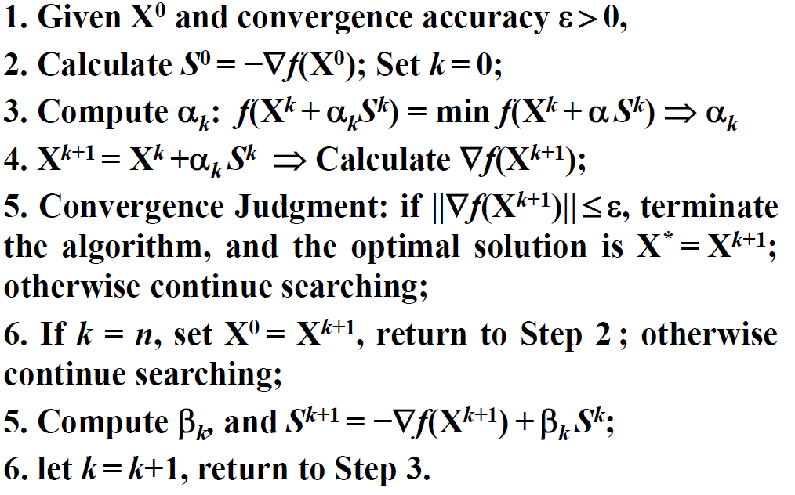

## 牛顿法

### 基本牛顿法

直接用一个二次函数拟合原优化函数，直接用新函数的最优点为下一次迭代点。即搜索方向为$S_k=-[H(X^k)]^{-1}\nabla f(X^k)$，其中$H(X^k)$为该点的Hessian矩阵，同时无需一维搜索，最优化步长因子始终为$1$。

特点:

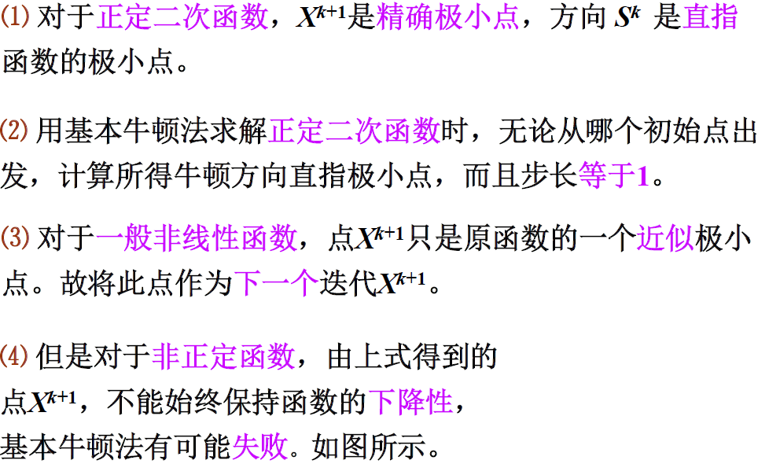

### 阻尼牛顿法

与牛顿法相比，引入可变的最优化步长因子，称为阻尼因子，而搜索方向不变，即$S_k=-[H(X^k)]^{-1}\nabla f(X^k)$，且$X^{k+1}=X^k+a_kS^k$。

迭代步骤:

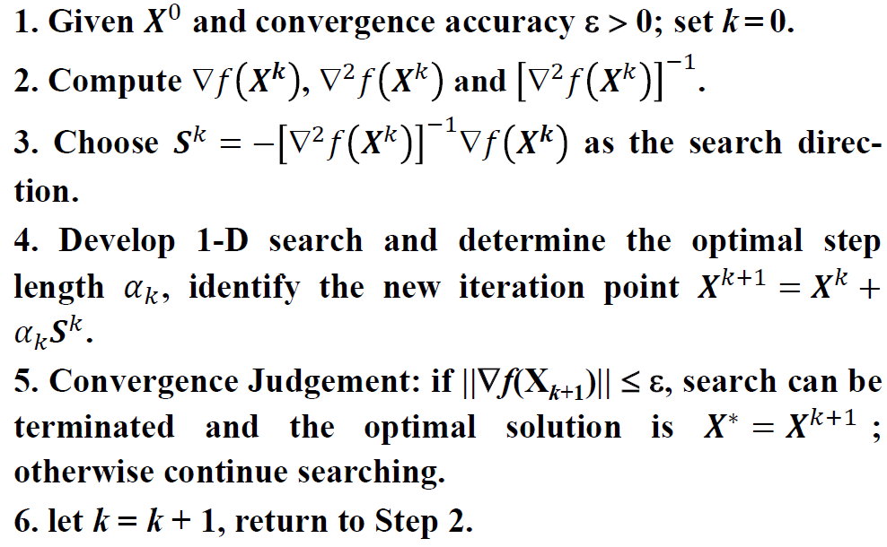

特点:

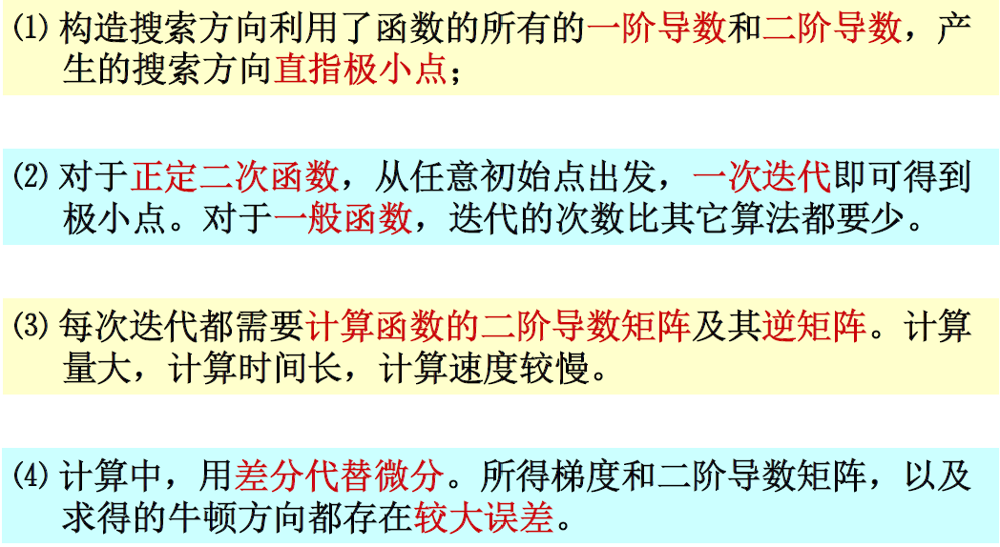

## 变尺度法（DFP）

变尺度法为拟牛顿法的一种，基本思想为构造一个矩阵，使其在计算中以递推的形式趋近$[H(X^k)]^{-1}$。

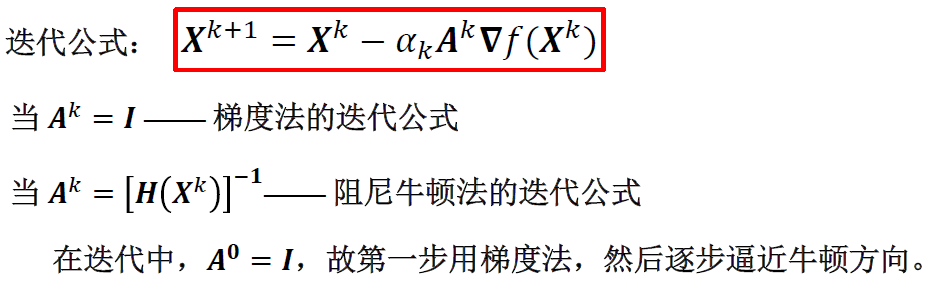

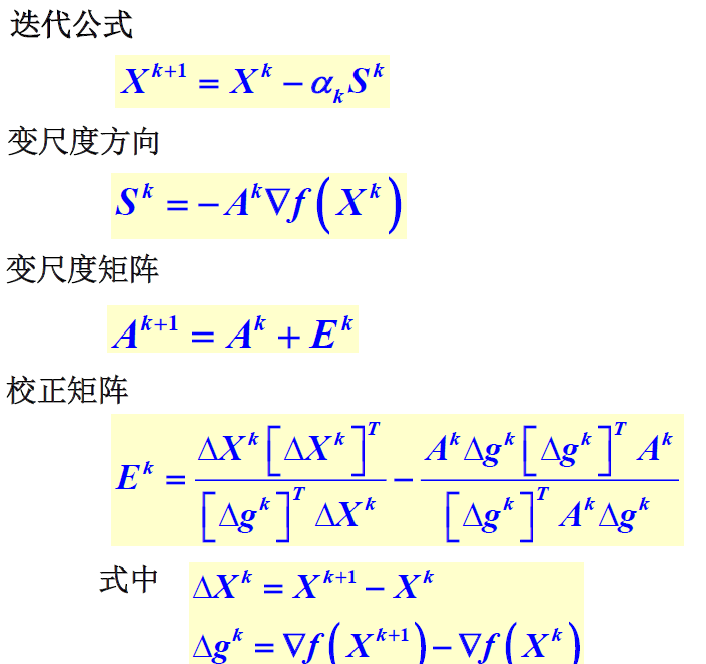

迭代步骤:

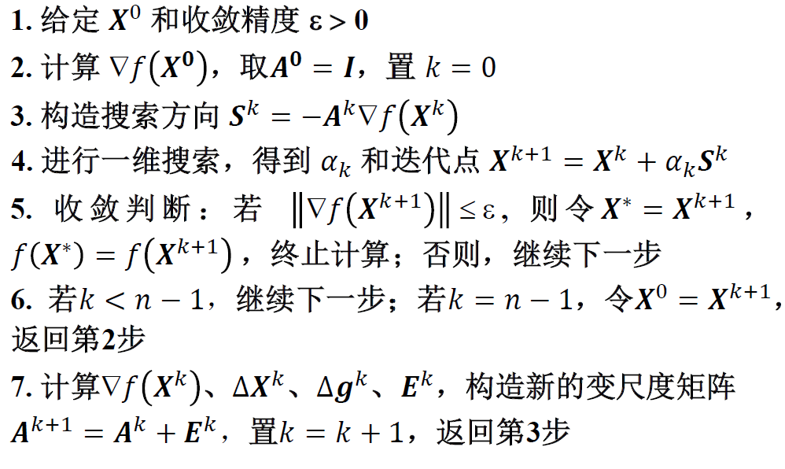

## 鲍威尔法

根据共轭方向的性质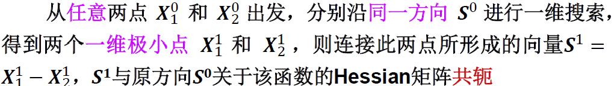

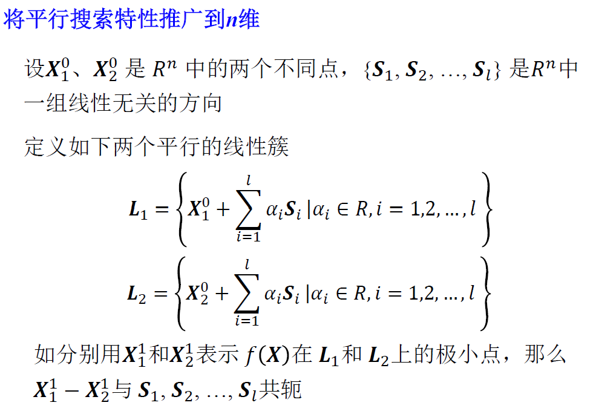
