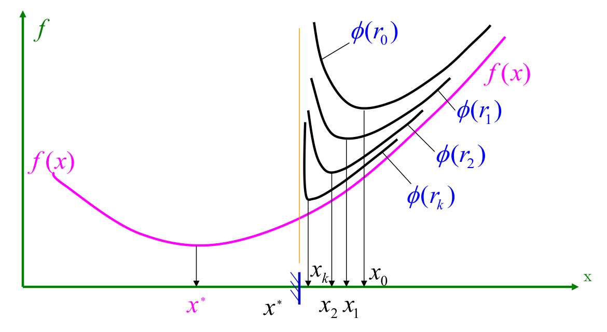
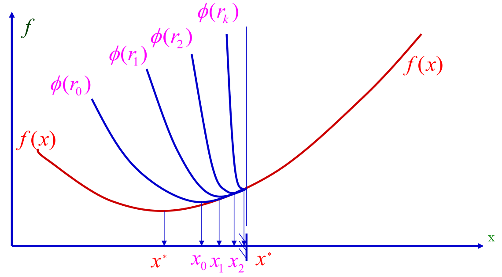

# 约束最优化方法

## 基本问题

**一般形式**：

$$
\begin{aligned}
\min\quad &f(X)\\
\text{s.t.}\quad &g_u(X)\le0,\quad u=1,2,\ldots,m,\\
&h_v(X)=0,\quad v=1,2,\ldots,p.
\end{aligned}
$$

其中 $X\in R^n$ 为设计变量，$g_u(X)$ 为不等式约束，$h_v(X)$ 为等式约束。

**方法分类**：

- **直接法**：直接考察约束，选择满足约束的搜索方向和步长，如可行方向法。
- **间接法**：把约束条件引入目标函数，将约束问题转化为一系列无约束问题，如惩罚函数法、乘子法。
- **序列二次规划法**：将原非线性约束问题逐次近似为二次规划问题，通过求解子问题确定搜索方向。

## 可行方向法

### 基本思想

对于只含不等式约束的问题，采用迭代公式

$$
X^{k+1}=X^k+\alpha_kS^k.
$$

选择方向 $S^k$ 和步长 $\alpha_k$，使新点既满足约束，又使目标函数下降：

$$
g_u(X^{k+1})\le0,\quad u=1,\ldots,m,\qquad
f(X^{k+1})<f(X^k).
$$

### 下降可行方向

**下降方向**：若

$$
[\nabla f(X^k)]^TS<0,
$$

则沿 $S$ 前进充分小的正步长，可使目标函数下降。

**起作用约束**：在当前点取等号的不等式约束，其下标集合为

$$
I_k=\{u\mid g_u(X^k)=0,\ u=1,2,\ldots,m\}.
$$

实际计算中给定边界容限 $\delta>0$，取

$$
I_k(X^k,\delta)=\{u\mid-\delta\le g_u(X^k)\le\delta\}.
$$

**可行方向**：若存在 $\bar\alpha>0$，使任意 $0<\alpha\le\bar\alpha$ 都满足 $X^k+\alpha S$ 可行，则称 $S$ 为可行方向。

- 当 $X^k$ 为严格内点时，任意方向在充分小步长下都是可行方向。
- 当 $X^k$ 位于约束边界时，若对所有 $u\in I_k$ 均有 $[\nabla g_u(X^k)]^TS<0$，则 $S$ 指向可行域内部。
- $[\nabla g_u(X^k)]^TS\le0$ 是常用的一阶线性化条件；取等号时，对非线性约束仍需检查实际可行性。

**下降可行方向**：同时满足下降条件和可行条件的方向。课件采用的严格向内条件为

$$
\begin{cases}
[\nabla f(X^k)]^TS<0,\\
[\nabla g_u(X^k)]^TS<0,\quad u\in I_k.
\end{cases}
$$

### 最佳下降可行方向

在给定方向分量范围内，使目标函数的一阶下降量最大的方向，由线性规划子问题确定：

$$
\begin{aligned}
\min_S\quad &[\nabla f(X^k)]^TS\\
\text{s.t.}\quad &[\nabla g_u(X^k)]^TS\le0,\quad u\in I_k,\\
&-1\le s_j\le1,\quad j=1,2,\ldots,n.
\end{aligned}
$$

其中 $S=(s_1,\ldots,s_n)^T$，梯度在 $X^k$ 处均为已知常向量。分量界用于限制方向尺度，避免子问题无界；求得 $S^*$ 后，令 $S^k=S^*$。

这里“最佳”指在线性近似和给定分量界下最佳，并不表示有限步长下目标函数实际下降量一定最大。课件前面使用严格不等式描述向内方向，计算步骤和例题则采用上述非严格不等式，允许沿线性约束边界搜索。

### 约束一维搜索

**约束一维搜索**：沿已确定的方向，考虑约束对步长的限制，求解

$$
\min_{\alpha\ge0}f(X^k+\alpha S^k),\qquad
\text{s.t.}\quad g_u(X^k+\alpha S^k)\le0.
$$

确定初始搜索区间时，对每一个探测点都进行可行性判断：

1. 若三个相邻探测点均可行，且函数值形成“大、小、大”，则得到初始搜索区间，再用一维搜索方法缩小区间。
2. 若探测点违反约束，则减小步长，使探测点回到可行侧或约束边界的容限范围内。
3. 若到达可行步长区间的边界时函数仍在下降，可将边界容限内的点作为该方向的近似极小点。

若沿该方向的可行步长为 $0\le\alpha\le\alpha_{\max}$，则无约束一维极小点超出此区间时，不能直接采用。

### 迭代步骤

1. 给定初始可行点 $X^0$、收敛精度 $\varepsilon>0$ 和边界容限 $\delta>0$，置 $k=0$。初始点可取严格内点，也可取能够确定可行方向的边界点。
2. 确定起作用约束集 $I_k(X^k,\delta)$。
3. 若 $I_k$ 为空，且 $\lVert\nabla f(X^k)\rVert\le\varepsilon$，则终止；否则取 $S^k=-\nabla f(X^k)$，转第 6 步。
4. 若 $I_k$ 非空，检查是否存在 $\lambda_u\ge0$，使 $\nabla f(X^k)+\sum_{u\in I_k}\lambda_u\nabla g_u(X^k)=0$。满足时可按一阶条件终止，否则继续。
5. 求解最佳下降可行方向的线性规划子问题，取 $S^k=S^*$。
6. 沿 $S^k$ 进行约束一维搜索，得到 $X^{k+1}$；置 $k=k+1$，返回第 2 步。

**特点**：直接利用约束信息，迭代点保持可行；需计算目标函数和约束的一阶导数，边界处通常还需解线性规划问题。一般非凸问题中，满足 K-T 条件只表示满足一阶必要条件，不能据此保证全局最优。

## 惩罚函数法

### 基本思想

根据约束函数构造惩罚项，将其加入目标函数，形成

$$
\phi(X,r_{k1},r_{k2})
=f(X)+r_{k1}G[g(X)]+r_{k2}H[h(X)],
$$

其中 $r_{k1},r_{k2}$ 为惩罚因子，$G,H$ 分别由不等式约束和等式约束构成。依次调整惩罚因子，求解一系列辅助极小化问题，使其极小点逼近原问题的最优点。

按惩罚项构造方式，分为**内点法、外点法和混合法**。以下内点法指课件中的障碍函数法。

### 内点法

**基本思想**：对不等式约束 $g_u(X)\le0$，在严格可行域 $g_u(X)<0$ 内构造障碍项，使函数在接近约束边界时趋于正无穷，阻止搜索越过边界。

**倒数形式**：

$$
\phi(X,r_k)=f(X)-r_k\sum_{u=1}^{m}\frac1{g_u(X)}.
$$

**对数形式**：

$$
\phi(X,r_k)=f(X)-r_k\sum_{u=1}^{m}\ln[-g_u(X)].
$$

两式均要求 $g_u(X)<0$、$r_k>0$。当某个 $g_u(X)\to0^-$ 时，障碍项趋于 $+\infty$。对数障碍项在整个内域中不一定非负，其关键性质是边界处趋于正无穷。

取递减的正惩罚因子序列

$$
r_0>r_1>\cdots>r_k>0,\qquad r_k\to0,
$$

逐次求辅助问题的极小点，在适当收敛条件下可从可行域内部逼近原问题的最优解。

**一维引例**：

$$
\min f(x)=x,\qquad\text{s.t.}\quad1-x\le0.
$$

原问题的最优解为 $x^*=1$。构造倒数障碍函数

$$
\phi(x,r_k)=x-\frac{r_k}{1-x}
=x+\frac{r_k}{x-1},\qquad x>1.
$$

由

$$
\frac{\partial\phi}{\partial x}=1-\frac{r_k}{(x-1)^2}=0
$$

得内域中的极小点

$$
x(r_k)=1+\sqrt{r_k},\qquad
\phi(x(r_k),r_k)=1+2\sqrt{r_k}.
$$

当 $r_k\to0$ 时，$x(r_k)\to1^+$，从可行侧逼近边界最优点。

**迭代步骤**：

1. 给定严格内点 $X^0$、精度 $\varepsilon$、初始因子 $r_0>0$ 和递减系数 $0<c<1$，置 $k=0$。
2. 构造倒数或对数形式的内点惩罚函数。
3. 以当前点为起点，在严格可行域内求 $\min_X\phi(X,r_k)$，记极小点为 $X^{k+1}$。
4. 若相邻点距离和目标函数相对变化均足够小，则停止；否则令 $r_{k+1}=cr_k$，置 $k=k+1$，返回第 2 步。

课件采用的终止指标为

$$
\lVert X^{k+1}-X^k\rVert\le\varepsilon,\qquad
\frac{|f(X^{k+1})-f(X^k)|}{|f(X^k)|}\le\varepsilon.
$$

当 $f(X^k)$ 接近零时，可用 $\max\{1,|f(X^k)|\}$ 作分母。课件给出的递减系数参考范围为 $c=0.02\sim0.1$。

**特点与问题**：

1. 初始点及搜索过程必须保持严格可行，得到的近似解始终可行。
2. 课件中的纯内点惩罚形式只处理不等式约束，不能直接用于等式约束。
3. 严格内点可能不易寻找，可利用已有可行设计、随机选点或专门搜索来产生。
4. 过于接近边界时，障碍函数变化陡峭，可能造成数值计算困难。

### 外点法

**基本思想**：只对违反约束的点施加惩罚；在可行域内惩罚项为零，辅助函数与原目标函数一致。初始点可在可行域内或域外，极小点序列通常从域外逼近约束最优点，但不要求所有迭代点始终在域外。

**不等式约束**：

$$
\phi(X,r_k)=f(X)+r_k\sum_{u=1}^{m}\{\max[g_u(X),0]\}^2.
$$

**等式约束**：

$$
\phi(X,r_k)=f(X)+r_k\sum_{v=1}^{p}[h_v(X)]^2.
$$

**混合约束的一般形式**：

$$
\phi(X,r_k)=f(X)
+r_k\sum_{u=1}^{m}\{\max[g_u(X),0]\}^2
+r_k\sum_{v=1}^{p}[h_v(X)]^2.
$$

若不等式写成 $g_u(X)\ge0$，相应惩罚项改为 $r_k\{\min[g_u(X),0]\}^2$。

取递增的正因子序列

$$
0<r_0<r_1<\cdots<r_k,\qquad r_k\to+\infty.
$$

惩罚因子越大，违反约束所付出的代价越高；在适当条件下，辅助问题的极小点趋向原约束问题的最优点。

**一维引例**：对 $\min x$、$1-x\le0$，构造

$$
\phi(x,r_k)=x+r_k[\max(1-x,0)]^2.
$$

在域外 $x<1$，由 $1-2r_k(1-x)=0$ 得

$$
x(r_k)=1-\frac1{2r_k},\qquad
\phi(x(r_k),r_k)=1-\frac1{4r_k}.
$$

当 $r_k\to+\infty$ 时，$x(r_k)\to1^-$，从不可行侧逼近最优点。

**迭代步骤**：

1. 给定初始点 $X^0$、精度 $\varepsilon$、初始因子 $r_0>0$ 和递增系数 $c>1$，置 $k=0$。
2. 构造外点惩罚函数。
3. 求解无约束问题 $\min_X\phi(X,r_k)$，得 $X^{k+1}$。
4. 检查相邻点距离、目标函数变化和约束违反量；满足精度时终止，否则令 $r_{k+1}=cr_k$，置 $k=k+1$，返回第 2 步。

课件给出的递增系数参考范围为 $c=5\sim10$。相邻点变化很小不一定表示约束已经满足，需同时检查约束违反量。

**特点**：初始点选取方便，能处理等式、不等式及混合约束；有限惩罚因子下的解可能不可行，因子过大又会使惩罚函数病态。

### 混合法

**基本思想**：不等式约束采用内点惩罚项，等式约束采用外点惩罚项。

**倒数形式**：

$$
\phi(X,r_{k1},r_{k2})=f(X)
-r_{k1}\sum_{u=1}^{m}\frac1{g_u(X)}
+r_{k2}\sum_{v=1}^{p}[h_v(X)]^2.
$$

**对数形式**：

$$
\phi(X,r_{k1},r_{k2})=f(X)
-r_{k1}\sum_{u=1}^{m}\ln[-g_u(X)]
+r_{k2}\sum_{v=1}^{p}[h_v(X)]^2.
$$

其中 $g_u(X)<0$，$r_{k1}\to0^+$，$r_{k2}\to+\infty$。若令

$$
r_{k1}=r_k,\qquad r_{k2}=\frac1{r_k},
$$

则可合并为单因子形式，例如

$$
\phi(X,r_k)=f(X)-r_k\sum_{u=1}^{m}\ln[-g_u(X)]
+\frac1{r_k}\sum_{v=1}^{p}[h_v(X)]^2,\qquad r_k\to0^+.
$$

## 乘子法

### 约束问题的极值条件

**等式约束**：构造拉格朗日函数

$$
L(X,\mu)=f(X)+\sum_{v=1}^{p}\mu_vh_v(X).
$$

在适当约束资格条件下，局部极小点满足

$$
\nabla_XL(X^*,\mu^*)
=\nabla f(X^*)+\sum_{v=1}^{p}\mu_v^*\nabla h_v(X^*)=0,\qquad
h_v(X^*)=0.
$$

等式约束乘子 $\mu_v$ 没有正负号限制，也允许全部为零。

**不等式约束及混合约束（K-T 条件）**：

$$
\begin{cases}
\displaystyle\nabla f(X^*)+\sum_{u=1}^{m}\lambda_u^*\nabla g_u(X^*)
+\sum_{v=1}^{p}\mu_v^*\nabla h_v(X^*)=0,\\
g_u(X^*)\le0,\quad h_v(X^*)=0,\\
\lambda_u^*\ge0,\quad\lambda_u^*g_u(X^*)=0.
\end{cases}
$$

其中 $\lambda_ug_u(X)=0$ 称为**互补松弛条件**：不起作用的不等式约束对应的乘子为零。

**几何意义**：只有不等式约束时，最优点处目标函数的负梯度是起作用约束梯度的非负线性组合；含等式约束时，再加上等式约束梯度的任意实系数组合。

K-T 条件在满足约束资格时是局部极小点的必要条件。若 $f,g_u$ 为凸函数且 $h_v$ 为仿射函数，则满足 K-T 条件的可行点是全局最优点。

### 基本思想

单纯外罚函数为了逼近边界最优点，往往要求 $r_k\to+\infty$，容易引起病态。乘子法用拉格朗日函数代替原目标函数，再加入二次惩罚项，形成**增广拉格朗日函数**。

同时修正设计变量和乘子，使乘子逐步逼近最优乘子，从而减少对极大惩罚因子的依赖。

### 等式约束问题的乘子法

对于 $h_v(X)=0$，构造

$$
\phi(X,\mu^k,r_k)=f(X)
+\sum_{v=1}^{p}\mu_v^kh_v(X)
+r_k\sum_{v=1}^{p}[h_v(X)]^2.
$$

固定 $\mu^k,r_k$，求得

$$
X^{k+1}=\arg\min_X\phi(X,\mu^k,r_k).
$$

其驻点条件为

$$
\nabla f(X^{k+1})+
\sum_{v=1}^{p}[\mu_v^k+2r_kh_v(X^{k+1})]\nabla h_v(X^{k+1})=0.
$$

与原问题的拉格朗日驻点条件比较，得**乘子更新公式**

$$
\mu_v^{k+1}=\mu_v^k+2r_kh_v(X^{k+1}),\qquad v=1,2,\ldots,p.
$$

若收敛较慢，可适当增大 $r_k$；不必像纯二次外罚法那样只依靠 $r_k\to\infty$ 来压低约束误差。

### 不等式约束问题的乘子法

对 $g_u(X)\le0$ 引入平方松弛变量：

$$
g_u(X)+z_u^2=0.
$$

建立增广拉格朗日函数

$$
\phi(X,Z,\lambda^k,r_k)=f(X)
+\sum_{u=1}^{m}\lambda_u^k[g_u(X)+z_u^2]
+r_k\sum_{u=1}^{m}[g_u(X)+z_u^2]^2.
$$

消去松弛变量后，得到

$$
\phi(X,\lambda^k,r_k)=f(X)
+\frac1{4r_k}\sum_{u=1}^{m}
\left\{[\max(2r_kg_u(X)+\lambda_u^k,0)]^2-(\lambda_u^k)^2\right\}.
$$

求得 $X^{k+1}$ 后，更新

$$
\lambda_u^{k+1}=\max\{\lambda_u^k+2r_kg_u(X^{k+1}),0\},\qquad u=1,\ldots,m.
$$

取 $\max$ 保证不等式乘子非负。

### 一般约束问题的乘子法

**增广拉格朗日函数**：

$$
\begin{aligned}
\phi(X,\mu^k,\lambda^k,r_k)
={}&f(X)+\sum_{v=1}^{p}\mu_v^kh_v(X)+r_k\sum_{v=1}^{p}[h_v(X)]^2\\
&+\frac1{4r_k}\sum_{u=1}^{m}
\left\{[\max(2r_kg_u(X)+\lambda_u^k,0)]^2-(\lambda_u^k)^2\right\}.
\end{aligned}
$$

**迭代步骤**：

1. 给定 $X^0$、初始乘子 $\mu^0$、$\lambda^0\ge0$、惩罚因子 $r_0>0$、因子调整系数 $c\ge1$ 和精度 $\varepsilon$，置 $k=0$。
2. 固定当前乘子和罚因子，求解 $\min_X\phi(X,\mu^k,\lambda^k,r_k)$，得到 $X^{k+1}$。
3. 按更新式计算 $\mu^{k+1}$ 和 $\lambda^{k+1}$，检查约束、互补性和驻点误差；满足精度则终止。
4. 必要时取 $r_{k+1}=cr_k$，也可保持 $r_{k+1}=r_k$；置 $k=k+1$，返回第 2 步。

一种与课件不等式乘子更新一致的约束及互补性残差为

$$
R_k=\left[
\sum_{u=1}^{m}\left\{\max\left[g_u(X^{k+1}),-\frac{\lambda_u^k}{2r_k}\right]\right\}^2
+\sum_{v=1}^{p}[h_v(X^{k+1})]^2
\right]^{1/2}.
$$

结合内层求解的驻点精度，可用 $R_k\le\varepsilon$ 判断收敛。该式也等于等式残差与归一化不等式乘子增量组成的范数。

**特点**：同时产生近似解序列和乘子序列；乘子更新不需求导，计算简单；通过调整乘子促进收敛，减轻过大惩罚因子导致的数值困难。

## 序列二次规划（SQP）算法

### 基本思想

**二次规划问题**：目标函数为二次函数，约束函数为线性函数的最优化问题。

SQP 在当前点 $X^k$ 附近对目标函数作二次近似，对约束函数作线性近似，求解得到搜索方向，再更新设计变量，形成一系列二次规划子问题。

令

$$
S=X-X^k,\qquad C^k=\nabla f(X^k).
$$

略去与 $S$ 无关的常数项，得到课件中的子问题

$$
\begin{aligned}
\min_S\quad &Q_k(S)=\frac12S^TH^kS+(C^k)^TS\\
\text{s.t.}\quad &h_v(X^k)+[\nabla h_v(X^k)]^TS=0,\quad v=1,\ldots,p,\\
&g_u(X^k)+[\nabla g_u(X^k)]^TS\le0,\quad u=1,\ldots,m.
\end{aligned}
$$

课件以目标函数 Hessian $\nabla^2f(X^k)$ 或其近似矩阵构造 $H^k$。标准 SQP 通常采用拉格朗日函数关于 $X$ 的 Hessian 或其近似，以计入非线性约束的曲率。

### 二次规划的矩阵形式

定义

$$
A_{eq}^k=
\begin{bmatrix}[\nabla h_1(X^k)]^T\\\vdots\\[\nabla h_p(X^k)]^T\end{bmatrix},\qquad
B_{eq}^k=-\begin{bmatrix}h_1(X^k)\\\vdots\\h_p(X^k)\end{bmatrix},
$$

$$
A^k=
\begin{bmatrix}[\nabla g_1(X^k)]^T\\\vdots\\[\nabla g_m(X^k)]^T\end{bmatrix},\qquad
B^k=-\begin{bmatrix}g_1(X^k)\\\vdots\\g_m(X^k)\end{bmatrix}.
$$

于是子问题可写成

$$
\begin{aligned}
\min_S\quad &\frac12S^TH^kS+(C^k)^TS\\
\text{s.t.}\quad &A_{eq}^kS=B_{eq}^k,\\
&A^kS\le B^k.
\end{aligned}
$$

求得最优解 $S^*$ 后，令 $S^k=S^*$，再通过步长搜索得到

$$
X^{k+1}=X^k+\alpha_kS^k.
$$

### 二阶导数矩阵的近似

为减少二阶导数计算，可采用拟牛顿更新。记

$$
s^k=X^{k+1}-X^k,\qquad
y^k=\nabla f(X^{k+1})-\nabla f(X^k).
$$

**DFP 逆 Hessian 更新**：

$$
D^{k+1}=D^k+
\frac{s^k(s^k)^T}{(y^k)^Ts^k}
-\frac{D^ky^k(y^k)^TD^k}{(y^k)^TD^ky^k}.
$$

此处 $D^k$ 近似 Hessian 的逆矩阵。课件第 66 页将该式记为 $H$ 的更新式，但它是逆 Hessian 更新，不能直接作为子问题中的 Hessian 使用。

若直接维护子问题的 $H^k$，可采用 **BFGS Hessian 更新**：

$$
H^{k+1}=H^k+
\frac{y^k(y^k)^T}{(y^k)^Ts^k}
-\frac{H^ks^k(s^k)^TH^k}{(s^k)^TH^ks^k}.
$$

当 $H^k$ 正定且 $(y^k)^Ts^k>0$ 时，该更新保持正定。标准 SQP 中 $y^k$ 通常由同一乘子下两点的拉格朗日函数梯度之差构造。

### 二次规划子问题的求解

**只有等式约束时**：对

$$
\min_S\frac12S^THS+C^TS,\qquad A_{eq}S=B_{eq},
$$

构造

$$
L(S,\nu)=\frac12S^THS+C^TS+\nu^T(A_{eq}S-B_{eq}).
$$

驻点条件与约束组成线性方程组

$$
\begin{bmatrix}
H&A_{eq}^T\\
A_{eq}&0
\end{bmatrix}
\begin{bmatrix}S\\\nu\end{bmatrix}
=\begin{bmatrix}-C\\B_{eq}\end{bmatrix}.
$$

若 $H$ 在约束的可行方向子空间上正定，且 $A_{eq}$ 行满秩，则该方程组给出唯一的极小解。方程数与未知数相等本身并不保证解唯一。

**含不等式约束时**：采用起作用约束的思想，将工作集中的不等式暂时作为等式，与原等式约束一起求解；随后检查全部不等式的可行性及对应乘子的非负性，必要时调整工作集。

### 迭代步骤

1. 给定初始点 $X^0$、精度 $\varepsilon$，取 $H^0=I$，置 $k=0$。
2. 在 $X^k$ 处构造目标函数的二次近似及约束的线性近似。
3. 求解二次规划子问题，得到方向 $S^k$。
4. 按课件进行约束一维搜索，确定 $\alpha_k$，得到 $X^{k+1}$。
5. 检查给定终止条件，满足则输出；否则更新二阶近似矩阵，置 $k=k+1$，返回第 2 步。

**说明**：非线性等式约束的线性化可行方向，不保证直线搜索中的点满足原等式。一般 SQP 需结合评价函数或其他步长策略，同时考虑目标下降和约束误差；不能把课件的“约束一维搜索”理解为对所有问题都能保持严格可行。

## 多目标最优化问题

### 数学模型与解的概念

工程设计常有多个相互制约的评价指标，其模型为

$$
\begin{aligned}
\min\quad &F(X)=[f_1(X),f_2(X),\ldots,f_q(X)]^T\\
\text{s.t.}\quad &g_u(X)\le0,\quad u=1,\ldots,m,\\
&h_v(X)=0,\quad v=1,\ldots,p.
\end{aligned}
$$

**完全最优解**：同一个可行点使所有分目标分别达到各自最优值，实际问题中不一定存在。

**支配关系与劣解**：若可行点 $Y$ 满足所有 $f_i(Y)\le f_i(X)$，且至少一个严格小于，则称 $Y$ 支配 $X$，$X$ 为被支配的劣解。

**有效解（Pareto 最优解）**：不存在其他可行点支配它。改善其中一个目标，必然使至少另一个目标变差。有效解之间通常需要按偏好取舍。

多目标优化一般通过构造综合目标或附加约束，转化为单目标问题求解。

### 主要目标法

选择最重要的目标 $f_z(X)$，将其余指标限定在可接受范围：

$$
\begin{aligned}
\min\quad &f_z(X)\\
\text{s.t.}\quad &g_u(X)\le0,\quad h_v(X)=0,\\
&\underline f_i\le f_i(X)\le\overline f_i,\quad i\ne z.
\end{aligned}
$$

其中 $\underline f_i,\overline f_i$ 为可接受的下限和上限。该法适合主次明确的问题，所得方案受指标范围的选择影响。

### 线性加权法

构造综合评价函数

$$
f(X)=\sum_{i=1}^{q}w_if_i(X),\qquad
w_i\ge0,\quad\sum_{i=1}^{q}w_i=1,
$$

在原可行域上求其最小值。$w_i$ 称为权因子，表示各目标的相对重要性。

**权因子的选择**：可根据经验、偏好和各指标的数值尺度确定。课件给出 $w_i\propto1/f_i^*$ 的参考做法，其中 $f_i^*$ 是第 $i$ 个目标单独优化的最优值；该做法只适用于最优值为正、非零且尺度解释合理的情形，必要时再归一化。

当所有 $w_i>0$ 时，综合目标的全局最优解是有效解。若部分权重为零，则可能只得到弱有效解；不同量纲的指标宜先作适当尺度处理。

### 理想点法

分别在原可行域上求各单目标最优值

$$
f_i^*=\min_{X\in D}f_i(X),\qquad i=1,\ldots,q,
$$

组成理想目标向量 $F^*=(f_1^*,\ldots,f_q^*)^T$。这些最优值通常由不同的设计点取得，理想向量不一定能同时实现。

课件先给出相对偏差形式

$$
\min_{X\in D}\sum_{i=1}^{q}\frac{f_i(X)-f_i^*}{f_i^*},
$$

该式要求分母为正、非零。更一般地，可选择正尺度对各目标的偏差归一化。

**加权平方偏差形式**：

$$
\min_{X\in D}\sum_{i=1}^{q}w_i[f_i(X)-f_i^*]^2,\qquad w_i>0.
$$

通过最小化各目标对理想值的偏离，求得折中方案。偏差的大小受权重和指标尺度影响。

### 目标逼近法

对每个目标取权系数 $w_i>0$，引入变量 $\gamma$，使其成为加权偏差的共同上界：

$$
\begin{aligned}
\min_{X,\gamma}\quad &\gamma\\
\text{s.t.}\quad &\frac{f_i(X)-f_i^*}{w_i}\le\gamma,\quad i=1,\ldots,q,\\
&g_u(X)\le0,\quad h_v(X)=0.
\end{aligned}
$$

即最小化各目标中最大的加权偏差，使所有目标尽可能接近各自的理想值。

### 最小最大法

不断压低当前最大的分目标值，模型为

$$
\min_{X\in D}\max_{i=1,\ldots,q}f_i(X).
$$

引入辅助变量 $t$，可等价写成

$$
\begin{aligned}
\min_{X,t}\quad &t\\
\text{s.t.}\quad &f_i(X)\le t,\quad i=1,\ldots,q,\\
&g_u(X)\le0,\quad h_v(X)=0.
\end{aligned}
$$

该法强调改善最差指标，各目标应具有可比较的尺度。目标逼近法与最小最大法一般保证弱有效性，若需排除被支配的并列最优方案，还需进一步择优。

## 方法比较

| 方法 | 主要思路 | 约束处理 | 参数或主要问题 |
|:---|:---|:---|:---|
| 可行方向法 | 选择下降且可行的方向 | 直接检查约束，进行约束一维搜索 | 需初始可行点，边界处需解方向子问题 |
| 内点法 | 在可行域内设置障碍 | 本章纯内点形式处理不等式约束 | 严格内点，$r_k\to0^+$ |
| 外点法 | 惩罚约束违反量 | 等式、不等式、混合约束 | 初始点不限，$r_k\to+\infty$ 时易病态 |
| 混合法 | 不等式用内罚，等式用外罚 | 保持不等式严格可行，逐步满足等式 | 内罚因子趋零，外罚因子趋无穷 |
| 乘子法 | 拉格朗日函数加二次惩罚 | 同时修正设计变量与乘子 | 减少对极大罚因子的依赖 |
| SQP | 逐次求解二次规划近似 | 线性化约束构造子问题 | 二阶矩阵近似、QP 求解与步长选择 |

## 例题

### 一

课件例 1：可行方向法。

$$
\begin{aligned}
\min\quad &f(X)=x_1^2+x_2^2-x_1x_2-2x_1-3x_2\\
\text{s.t.}\quad &g_1(X)=x_1+x_2-2\le0,\\
&g_2(X)=x_1+5x_2-5\le0,\\
&g_3(X)=-x_1\le0,\quad g_4(X)=-x_2\le0.
\end{aligned}
$$

**解**：取 $X^0=(0,0)^T$，起作用约束集 $I_0=\{3,4\}$，且

$$
\nabla f(X^0)=(-2,-3)^T,\qquad
\nabla g_3=(-1,0)^T,\quad\nabla g_4=(0,-1)^T.
$$

若满足 K-T 条件，则需 $\lambda_3=-2$、$\lambda_4=-3$，不满足非负性，继续迭代。

**第一次迭代**：方向子问题为

$$
\min(-2s_1-3s_2),\qquad
-s_1\le0,\quad-s_2\le0,\quad-1\le s_1,s_2\le1.
$$

解得 $S^0=(1,1)^T$。沿该方向

$$
X(\alpha)=(\alpha,\alpha)^T,\qquad f(X(\alpha))=\alpha^2-5\alpha.
$$

无约束一维极小点为 $\alpha=5/2$，但约束要求 $2\alpha\le2$、$6\alpha\le5$，故可行步长为 $0\le\alpha\le5/6$。因此

$$
\alpha_0=\frac56,\qquad X^1=\left(\frac56,\frac56\right)^T.
$$

此时只有 $g_2$ 起作用，且

$$
\nabla f(X^1)=\left(-\frac76,-\frac{13}6\right)^T.
$$

不存在同一个非负 $\lambda_2$ 使 $\nabla f(X^1)+\lambda_2(1,5)^T=0$，故未达到最优。

**第二次迭代**：求解

$$
\min\left(-\frac76s_1-\frac{13}6s_2\right),\qquad
s_1+5s_2\le0,\quad-1\le s_1,s_2\le1,
$$

得 $S^1=(1,-1/5)^T$。于是

$$
X(\alpha)=\left(\frac56+\alpha,\frac56-\frac\alpha5\right)^T,
$$

$$
f(X(\alpha))=-\frac{125}{36}-\frac{11}{15}\alpha+\frac{31}{25}\alpha^2.
$$

由导数为零得 $\alpha_1=55/186$。原约束给出的步长上界为 $5/12$，故该步长可行，得到

$$
X^2=\left(\frac{35}{31},\frac{24}{31}\right)^T,\qquad f(X^2)=-\frac{111}{31}.
$$

在此点

$$
\nabla f(X^2)=\left(-\frac{16}{31},-\frac{80}{31}\right)^T,
\qquad\lambda_2=\frac{16}{31}>0,
$$

满足 $\nabla f(X^2)+\lambda_2\nabla g_2=0$。由于目标函数 Hessian 为 $\begin{pmatrix}2&-1\\-1&2\end{pmatrix}$，正定，约束均为线性约束，故

$$
X^*=\left(\frac{35}{31},\frac{24}{31}\right)^T,\qquad f^*=-\frac{111}{31}.
$$

*第六章课件 PDF 第 13-18 页。*

### 二

课件例 2：内点法。

$$
\begin{aligned}
\min\quad &f(X)=x_1+x_2\\
\text{s.t.}\quad &g_1(X)=x_1^2-x_2\le0,\\
&g_2(X)=-x_1\le0.
\end{aligned}
$$

**解**：在严格内域 $x_1>0$、$x_2>x_1^2$，构造对数障碍函数

$$
\phi(X,r)=x_1+x_2-r[\ln(x_2-x_1^2)+\ln x_1],\qquad r>0.
$$

令偏导数为零：

$$
\frac{\partial\phi}{\partial x_1}
=1+\frac{2rx_1}{x_2-x_1^2}-\frac r{x_1}=0,\qquad
\frac{\partial\phi}{\partial x_2}=1-\frac r{x_2-x_1^2}=0.
$$

第二式给出 $x_2=x_1^2+r$，代入第一式得 $2x_1^2+x_1-r=0$，取正根：

$$
x_1(r)=\frac{\sqrt{1+8r}-1}{4},\qquad
x_2(r)=\frac{(\sqrt{1+8r}-1)^2}{16}+r.
$$

取递减的罚因子，计算得：

| $r$ | $x_1(r)$ | $x_2(r)$ | $f(X(r))$ |
|:---:|---:|---:|---:|
| 1 | 0.500000 | 1.250000 | 1.750000 |
| $1/2$ | 0.309017 | 0.595492 | 0.904508 |
| $1/4$ | 0.183013 | 0.283494 | 0.466506 |
| $1/8$ | 0.103553 | 0.135723 | 0.239277 |
| $0^+$（极限） | 0 | 0 | 0 |

每个 $r>0$ 都有 $x_1>0$、$x_2-x_1^2=r>0$，因此极小点均严格可行，且

$$
X(r)\to X^*=(0,0)^T,\qquad f^*=0.
$$

*第六章课件 PDF 第 28-30 页。表中按解析式重新计算，修正第 30 页 $r=1/2$ 时的 $x_2$、目标函数值及其他舍入误差。*

### 三

课件例 3：外点法，求解例二中的同一问题。

**解**：构造完整的外罚函数

$$
\phi(X,r)=x_1+x_2
+r[\max(x_1^2-x_2,0)]^2+r[\max(-x_1,0)]^2.
$$

在两个约束都被违反的区域 $x_1<0$、$x_2<x_1^2$，有

$$
\phi(X,r)=x_1+x_2+r(x_1^2-x_2)^2+rx_1^2.
$$

令偏导数为零：

$$
\begin{cases}
1+4rx_1(x_1^2-x_2)+2rx_1=0,\\
1-2r(x_1^2-x_2)=0.
\end{cases}
$$

第二式给出 $x_1^2-x_2=1/(2r)$，代入第一式得

$$
x_1(r)=-\frac1{2(1+r)},\qquad
x_2(r)=\frac1{4(1+r)^2}-\frac1{2r}.
$$

这组解对任意 $r>0$ 都满足上述区域条件。完整罚函数为凸函数，故该驻点为其全局极小点。

| $r$ | $x_1(r)$ | $x_2(r)$ | $f(X(r))$ |
|:---:|---:|---:|---:|
| 1 | $-1/4$ | $-7/16$ | $-11/16\approx-0.687500$ |
| 2 | $-1/6$ | $-2/9$ | $-7/18\approx-0.388889$ |
| 3 | $-1/8$ | $-29/192$ | $-53/192\approx-0.276042$ |
| 4 | $-1/10$ | $-23/200$ | $-43/200=-0.215000$ |

当 $r\to+\infty$ 时，$X(r)\to(0,0)^T$，$f(X(r))\to0$。有限 $r$ 下这些点均不满足原约束，体现了外点法从域外逼近最优点的过程。

*第六章课件 PDF 第 39-41 页。课件中的两个平方惩罚项同时展开，仅适用于两个约束同时被违反的区域。*

### 四

课件例 4：乘子法。

$$
\min f(X)=x_1^2+x_2^2,\qquad\text{s.t.}\quad g(X)=1-x_1\le0.
$$

**解**：构造

$$
\phi(X,\lambda,r)=x_1^2+x_2^2+
\frac{[\max(2r(1-x_1)+\lambda,0)]^2-\lambda^2}{4r}.
$$

在 $2r(1-x_1)+\lambda>0$ 的分支，令偏导数为零：

$$
2x_1-\lambda-2r(1-x_1)=0,\qquad2x_2=0,
$$

得

$$
x_1=\frac{r+\lambda/2}{1+r},\qquad x_2=0.
$$

取固定罚因子 $r=2$、初始乘子 $\lambda^0=0$，每次求解辅助问题后按

$$
\lambda^{k+1}=\max\{\lambda^k+4(1-x_1^{k+1}),0\}
$$

更新乘子。统一把第 $k$ 次辅助求解的结果记为 $X^{k+1}$，有：

| $k$ | 输入乘子 $\lambda^k$ | $x_1^{k+1}$ | $x_2^{k+1}$ | 更新乘子 $\lambda^{k+1}$ |
|:---:|---:|---:|---:|---:|
| 0 | 0 | $2/3$ | 0 | $4/3$ |
| 1 | $4/3$ | $8/9$ | 0 | $16/9$ |
| 2 | $16/9$ | $26/27$ | 0 | $52/27$ |
| 3 | $52/27$ | $80/81$ | 0 | $160/81$ |

由更新关系可得

$$
x_1^{k+1}=1-\frac1{3^{k+1}},\qquad
\lambda^{k+1}=2\left(1-\frac1{3^{k+1}}\right).
$$

因此无需令罚因子趋于无穷，便可得到

$$
X^*=(1,0)^T,\qquad f^*=1,\qquad\lambda^*=2.
$$

*第六章课件 PDF 第 59-62 页。课件将首次辅助求解结果记为 $X^0$，此处统一采用算法中的 $X^{k+1}$ 下标。*

### 五

课件例 5：等式约束二次规划。

$$
\begin{aligned}
\min\quad &f(X)=\frac12(x_1^2+x_2^2+x_3^2)\\
\text{s.t.}\quad &x_1+2x_2-x_3=4,\\
&x_1-x_2+x_3=-2.
\end{aligned}
$$

**解**：该问题已是二次规划，取

$$
H=I_3,\qquad C=0,\qquad
A_{eq}=\begin{pmatrix}1&2&-1\\1&-1&1\end{pmatrix},\qquad
B_{eq}=\begin{pmatrix}4\\-2\end{pmatrix}.
$$

令 $L(X,\nu)=\frac12X^TX+\nu^T(A_{eq}X-B_{eq})$，得到

$$
\begin{bmatrix}
1&0&0&1&1\\
0&1&0&2&-1\\
0&0&1&-1&1\\
1&2&-1&0&0\\
1&-1&1&0&0
\end{bmatrix}
\begin{bmatrix}x_1\\x_2\\x_3\\\nu_1\\\nu_2\end{bmatrix}
=\begin{bmatrix}0\\0\\0\\4\\-2\end{bmatrix}.
$$

求解得

$$
X^*=\left(\frac27,\frac{10}7,-\frac67\right)^T,\qquad
\nu^*=\left(-\frac47,\frac27\right)^T.
$$

由于 $H=I_3$ 正定，且两条等式独立，该解为唯一全局最优解，目标函数值为

$$
f^*=\frac12\left[\left(\frac27\right)^2+
\left(\frac{10}7\right)^2+\left(-\frac67\right)^2\right]=\frac{10}7.
$$

*第六章课件 PDF 第 71-72 页。*

### 六

课件例 6：序列二次规划法。

$$
\min f(X)=x_1^3+x_2^3,\qquad\text{s.t.}\quad h(X)=x_1+x_2-1=0.
$$

**解**：取 $X^0=(1,0)^T$、$H^0=I_2$。此时

$$
C^0=\nabla f(X^0)=(3,0)^T,\qquad
\nabla h(X^0)=(1,1)^T,\qquad h(X^0)=0.
$$

构造二次规划子问题

$$
\min Q_0(S)=\frac12s_1^2+\frac12s_2^2+3s_1,\qquad
\text{s.t.}\quad s_1+s_2=0.
$$

其拉格朗日函数为

$$
L(S,\nu)=\frac12s_1^2+\frac12s_2^2+3s_1+\nu(s_1+s_2).
$$

由驻点条件

$$
s_1+3+\nu=0,\qquad s_2+\nu=0,\qquad s_1+s_2=0
$$

得 $S^0=(-3/2,3/2)^T$、$\nu=-3/2$。沿该方向

$$
X(\alpha)=\left(1-\frac32\alpha,\frac32\alpha\right)^T,
$$

原等式始终满足，且

$$
f(X(\alpha))=
\left(1-\frac32\alpha\right)^3+\left(\frac32\alpha\right)^3
=1-\frac92\alpha+\frac{27}4\alpha^2.
$$

令导数为零，得 $\alpha_0=1/3$，故

$$
X^1=X^0+\frac13S^0=\left(\frac12,\frac12\right)^T.
$$

由约束消去 $x_2=1-x_1$ 后，原目标函数为

$$
f(X)=x_1^3+(1-x_1)^3=3\left(x_1-\frac12\right)^2+\frac14,
$$

因此

$$
X^*=\left(\frac12,\frac12\right)^T,\qquad f^*=\frac14.
$$

*第六章课件 PDF 第 73-75 页。*
